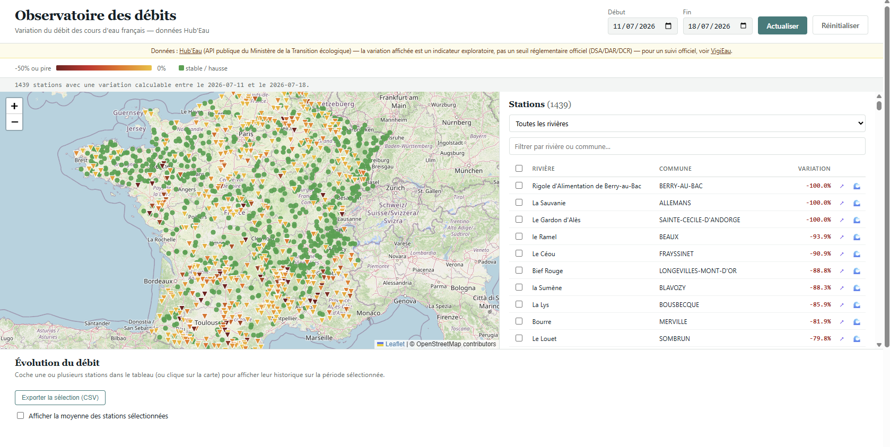
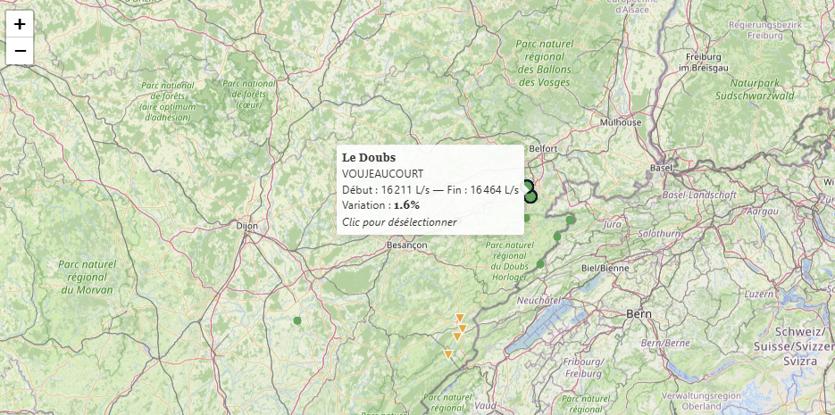
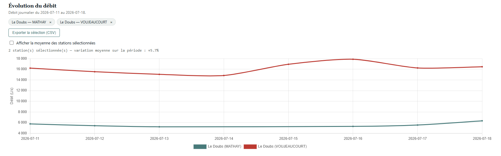
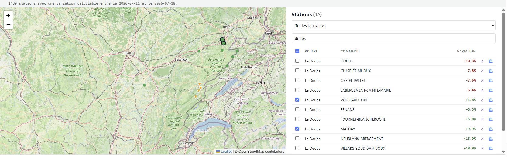

# Débits des rivières — Observatoire

Un outil en ligne de commande et un tableau de bord interactif pour suivre l'évolution du débit des rivières françaises, à partir des données publiques [Hub'Eau](https://hubeau.eaufrance.fr/).

Projet né pendant la canicule de juillet 2026, en observant l'assèchement de l'Allan à Montbéliard, et occasion de pratiquer Python (data/pandas) après une reconversion PHP/Symfony vers la data.



## Ce que ça fait

**`analyse.py`** — un analyseur CLI qui :

- charge deux relevés journaliers (début / fin de période)
- nettoie les données (débits négatifs, révisions dupliquées)
- calcule la variation de débit par station entre les deux dates
- affiche un rapport (stats descriptives, top 10 des plus fortes baisses)
- exporte le référentiel des stations pour le dashboard (`stations_ref.js`)

**`dashboard.html`** — un tableau de bord interactif (un seul fichier HTML/JS, sans framework ni build) qui :

- affiche une carte de France colorée selon la variation de débit (dégradé + forme distincte pour l'accessibilité), avec zoom par Ctrl + molette
- propose une période en boutons (7 jours, 30 jours, personnalisée) et des chiffres clés (stations calculées, baisses de 50 % ou plus)
- interroge l'API Hub'Eau en direct pour une période choisie dynamiquement
- permet de sélectionner des stations (sur la carte ou dans la liste, avec recherche, filtre par rivière et tri) et de comparer leur historique sur un graphique
- exporte les données sélectionnées en CSV
- renvoie vers les fiches officielles (Vigicrues, HydroPortail) pour chaque station
- signale les stations dont le débit du jour de fin est nul mais non qualifié par Hub'Eau

## Aperçu


_Carte interactive avec dégradé de couleur selon la variation de débit_


_Graphique d'historique, plusieurs stations superposées_


_Tableau triable/filtrable, sélection synchronisée avec la carte_

## Installation

Prérequis : Python 3.11 ou plus (testé avec 3.13)

```bash
git clone https://github.com/raphael25200/hydro-observatoire.git
cd hydro-observatoire
python -m venv venv
.\venv\Scripts\Activate.ps1      # Windows PowerShell
pip install -r requirements.txt
```

## Utilisation

### 1. Récupérer des données (API Hub'Eau)

```powershell
Invoke-WebRequest -Uri "https://hubeau.eaufrance.fr/api/v2/hydrometrie/obs_elab.csv?grandeur_hydro_elab=QmnJ&date_debut_obs_elab=2026-07-08&date_fin_obs_elab=2026-07-08&size=6000" -OutFile "jour_debut.csv"
Invoke-WebRequest -Uri "https://hubeau.eaufrance.fr/api/v2/hydrometrie/obs_elab.csv?grandeur_hydro_elab=QmnJ&date_debut_obs_elab=2026-07-15&date_fin_obs_elab=2026-07-15&size=6000" -OutFile "jour_fin.csv"
```

(Le référentiel des stations, `toutes_stations.csv`, est déjà inclus dans le repo — pas besoin de le retélécharger sauf si tu veux des données à jour.)

Le `toutes_stations.csv` versionné contient les 6 525 stations du référentiel Hub'Eau (état du 29 octobre 2026). Pour le mettre à jour, utiliser la commande suivante :

```powershell
Invoke-WebRequest -Uri "https://hubeau.eaufrance.fr/api/v2/hydrometrie/referentiel/stations.csv?size=10000" -OutFile "toutes_stations.csv"
```

`analyse.py` régénère ensuite `stations_ref.js` à partir de ce fichier (étape 2).

### 2. Lancer l'analyse

```powershell
python analyse.py jour_debut.csv jour_fin.csv --date-debut 2026-07-08 --date-fin 2026-07-15
```

### 3. Ouvrir le dashboard

Le dashboard n'a pas besoin de la partie Python : il lit `stations_ref.js` (même dossier) et interroge l'API Hub'Eau en direct. Le plus fiable est de le servir en local :

```powershell
python -m http.server 8000
```

puis d'ouvrir `http://localhost:8000/dashboard.html`. L'ouverture directe du fichier peut être bloquée selon le navigateur ou ses extensions.

## Stack technique

- **Python** / **pandas** — nettoyage, jointures, agrégation
- **JavaScript vanilla** / **Leaflet** 1.9.4 (carte) / **Chart.js** 4.4.4 (graphiques), chargés depuis un CDN — pas de framework, pas de build, un seul fichier HTML
- **API Hub'Eau** (Ministère de la Transition écologique) — source des données

## Méthodologie et limites

- Le "% de variation" affiché est un **indicateur exploratoire maison**, calculé sur la période choisie. Il ne correspond **pas** aux seuils réglementaires officiels de sécheresse (DSA/DAR/DCR), qui reposent sur des débits seuils absolus propres à chaque station, définis par arrêté préfectoral. Pour un suivi officiel : [VigiEau](https://vigieau.gouv.fr).
- Les mesures qualifiées "douteuse", "incertaine" ou "mauvaise" par Hub'Eau sont exclues du calcul, dans `analyse.py` comme dans le dashboard. Les mesures "non qualifiée" sont conservées ; sur le graphique, elles sont dessinées en points creux.
- Un débit nul le jour de fin avec une mesure non qualifiée est signalé ("Débit nul non validé") mais pas exclu : il peut être corrigé par Hub'Eau quelques jours plus tard.
- Les stations absentes du référentiel local (`toutes_stations.csv`) n'ont pas de coordonnées et sont ignorées ; `analyse.py` en affiche le nombre.
- La carte est limitée à la France métropolitaine. Les stations d'outre-mer restent dans le tableau et le graphique, mais ne sont pas accessibles depuis la carte.
- Les données très récentes (< 3 jours environ) sont souvent encore en cours de validation côté Hub'Eau et peuvent être incomplètes.

## Quelques problèmes réels rencontrés (et corrigés)

Pour la transparence — et parce que ça fait partie de l'apprentissage :

- **Doublons de révision** : Hub'Eau republie parfois une mesure corrigée sous une nouvelle ligne (même jour, `date_prod` différent). Sans déduplication, un `merge()` naïf peut produire des jointures explosives (des millions de lignes au lieu de quelques milliers).
- **Mauvais nom de paramètre d'API** : `code_station` semble être le nom logique pour filtrer une station sur l'endpoint `obs_elab`, mais Hub'Eau attend en réalité `code_entite`. Sans ce paramètre correct, l'API ignore silencieusement le filtre et renvoie les données nationales non filtrées — aucune erreur explicite, juste des résultats incohérents à déboguer.
- **Valeurs aberrantes non signalées** : certaines mesures brutes contiennent des valeurs physiquement impossibles (débits négatifs, pics ×1000), sans toujours être marquées comme telles par l'API.

## Licence des données

Données Hub'Eau sous [licence ouverte Etalab 2.0](https://github.com/etalab/licence-ouverte/blob/master/LO.md).

## Licence

Le code de ce dépôt est distribué sous licence MIT (voir le fichier `LICENSE`). Les données Hub'Eau restent sous licence ouverte Etalab 2.0.

## Auteur

Raphaël Navarro — [LinkedIn](https://www.linkedin.com/in/navarroraphael/) · [Malt](https://www.malt.fr/profile/raphaelnavarro)
